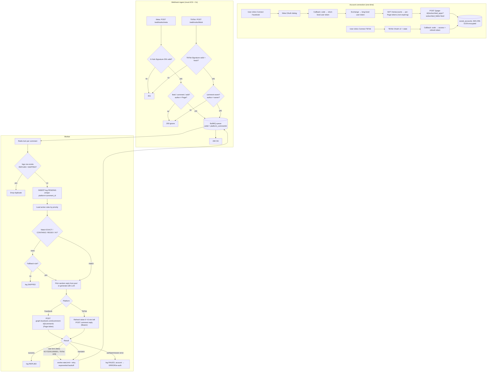

# Social Auto-Reply — System Architecture

## 1. Components

| Component | Tech | Responsibility |
|---|---|---|
| **Web API** | Express (TS) | OAuth flows, rule CRUD, logs API, **webhook listener** |
| **Queue** | Redis + BullMQ | Decouples webhook ACK from reply work; retries, delays, rate-limit pauses |
| **Worker** | Node (BullMQ Worker) | Dedupe → rule match → (AI) → post reply → log |
| **Database** | PostgreSQL | users, social_accounts, automation_rules, logs |
| **Token scheduler** | BullMQ repeatable job | Refresh TikTok tokens ahead of expiry; flag accounts needing re-auth |
| **Secrets** | Env / KMS | `TOKEN_ENC_KEY` (AES-256), app secrets |

Web API and Worker are separate processes (`npm run dev` / `npm run worker`) so reply load never starves webhook ACKs.

## 2. End-to-end flow



## 3. OAuth details

### Facebook
Permissions to request (App Review required for Advanced Access to each):

| Permission | Why |
|---|---|
| `pages_show_list` | **Needed** to list the user's Pages via `/me/accounts` (not in the original brief) |
| `pages_manage_metadata` | Subscribe the Page to webhook fields |
| `pages_read_engagement` + `pages_read_user_content` | Read comments / user content on Page posts |
| `pages_manage_engagement` | **Needed** to reply to comments (not in the original brief; `pages_manage_posts` alone doesn't cover it) |
| `pages_manage_posts` | Only if you also publish posts; drop it otherwise (least privilege) |
| `pages_messaging` | Only for private replies (Messenger) |

Token flow: code → user token → `GET /oauth/access_token?grant_type=fb_exchange_token` → long-lived user token → `GET /me/accounts` returns **Page tokens that don't expire** when derived from a long-lived user token. Store per Page, encrypted. Then subscribe: `POST /{page-id}/subscribed_apps?subscribed_fields=feed`.

Webhook setup (App Dashboard → Webhooks → *Page*): callback `https://<host>/webhooks/meta`, verify token = `META_VERIFY_TOKEN`, subscribe to `feed`.

### TikTok
Authorize at `https://www.tiktok.com/v2/auth/authorize/` with `client_key`, `scope`, `redirect_uri`, `state` (CSRF). Exchange at `https://open.tiktokapis.com/v2/oauth/token/`. Access tokens are short-lived (~24h); refresh tokens last longer (~1 year) and **may rotate** on every refresh, so the refresh path (`getFreshTikTokToken`) takes a per-account Postgres advisory lock and always stores the newest refresh token.

## 4. Dedupe & idempotency (defence in depth)
1. **BullMQ `jobId`** = `platform_commentId` → redelivered webhooks collapse while the job is retained (24h).
2. **Redis `SET NX` lock** per comment → two workers can't process the same comment concurrently.
3. **`UNIQUE (platform, comment_id)`** on `logs` → permanent guarantee; the worker exits early for `REPLIED`/`SKIPPED`.
4. **Self-reply guard** in the webhook: ignore comments whose author is the Page/owner, otherwise your own reply triggers another reply.

Residual risk: if the process dies *after* the platform accepted the reply but *before* the `REPLIED` update, a retry could double-post. Neither API offers an idempotency key; the window is tiny, and the log row (`replyText` written before the call) makes such cases auditable.

## 5. Rate limiting & anti-spam
- **Backoff:** queue-level exponential (2s → 32s, 6 attempts). Explicit rate-limit errors (Meta 4/17/32/613/80001, TikTok 429 with `Retry-After`) call `worker.rateLimit()` so the whole worker pauses instead of hammering the API.
- **Jitter:** `REPLY_DELAY_MIN_S/MAX_S` delays each reply a few seconds so replies don't land instantly and uniformly.
- **Variation pools:** random choice from `reply_template[]`.
- **Policy reality check:** Meta and TikTok both police repetitive/automated engagement. Keep replies relevant, cap per-post/per-hour volume, offer an opt-out per rule, and don't auto-reply to every comment on every post. Consider adding a per-account hourly cap before launch.

## 6. TikTok — items to verify before building further
These are the places where I can't confirm public platform behaviour from memory, so treat them as open questions, not facts:
1. **Comment webhook:** TikTok's documented webhook events are narrower than Meta's. The `comment.create` handler is an assumption. If your approved product doesn't push comment events, replace the TikTok ingest with a **poller**: a repeatable BullMQ job per account that lists recent videos (`video.list`) → lists comments → enqueues unseen `comment_id`s into the same queue. Everything downstream is unchanged.
2. **Reply endpoint / scopes:** `https://open.tiktokapis.com/v2/comment/reply/` and the `comment.list` / `comment.list.manage` scopes are taken from your brief. Comment management is typically gated behind a specific TikTok product (Business/Accounts API) and approval. Confirm the exact path, request body, and character limit in your developer portal; `replyOnTikTok()` in `src/platforms.ts` is the only function to change.

## 7. Security checklist
- Tokens: AES-256-GCM, random 96-bit IV per value, key-version prefix for rotation; move the key to a KMS.
- Webhooks: HMAC verification on raw bytes, constant-time compare, TikTok timestamp window.
- OAuth: random `state` bound to session; PKCE where supported; exact-match redirect URIs.
- LLM replies: comment text is untrusted (prompt-injection); the system prompt fences it, output is length-capped, no links by default. Add a moderation pass for brand-sensitive accounts.
- Regex rules: executed with RE2 (linear time) with pattern/comment length caps.
- Logs contain user comment text (personal data): define retention (e.g. 90 days) and honour Meta/TikTok data-deletion callbacks.

## 8. Running it
```bash
cp .env.example .env            # fill secrets; openssl rand -base64 32 → TOKEN_ENC_KEY
npm install
npx prisma migrate deploy       # applies prisma/migrations/0001_init
npx prisma generate
npm run dev                     # webhook/API on :3000  (expose via HTTPS tunnel for Meta)
npm run worker                  # reply worker
```
Not yet built (next step): OAuth callback routes, rules CRUD API, token-refresh scheduler, TikTok poller, dashboard UI.
